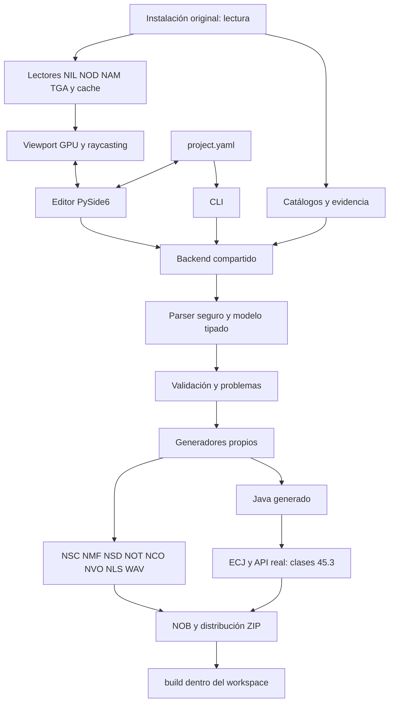

# Arquitectura

## Extensión opt-in de Fase 9

Fuente schema2/project_format9 → prepare → perfil phase9 → Campaign validado → generador compartido + runtime9 → instrumentación → ECJ → readback/Code budgets → paquete. La rama antigua no emite los campos/helpers nuevos; Golden y Fase2 conservan sus hashes. authoring9 valida marcadores/recorridos, runtime9 amplía el Java contrastado. No añade ejecutor narrativo alternativo ni parser paralelo de conversaciones.

CampaignDocument mantiene entries/waypoints de la escena activa como referencias al único fuente. Paths se muestran como enlaces de esos puntos. Arrival aplica transform después de Jump; restore evita recolocación. Patrol mantiene índice/espera/activo. Los eventos once reservan checkpoint por acción y flag de progreso, reanudándose aunque acciones anteriores alteren sus condiciones. No existe atomicidad entre efecto nativo y checkpoint. El layout y sus parámetros forman parte de la firma persistida.

Deploy guarda `.rcm_deployment.json` en su carpeta: hashes de propiedad, obsoletos verificados y backup transaccional. Conserva ajenos/modificados. La limpieza puntual de demos se registra aparte y copia57 archivos retirados a `research/phase9/retired_all_demos.zip`. Sólo se escribe dentro de RCM; los originales no son destinos.

## Estabilización 0.7.0

`scene_profiles` separa el entorno de la selección de geometría y del anchor del controlador. Valida asociación, versión y hash del NSD original; preserva sus 176 bytes sin decodificar campos inciertos. CLI/GUI y campañas comparten la misma propiedad YAML `level.environment_scene`. El scanner añade escenas estáticas por pareja NIL/NSD, sin inferir nombres desde NSS. Los fingerprints incorporan los originales de entorno utilizados. Ver [SCENE_MODEL.md](SCENE_MODEL.md).

Diagnósticos y compatibilidad de paquetes utilizan `rcm.__version__`, evitando valores de versión divergentes. Los informes históricos y los paquetes NOB de regresión conservan su evidencia y hashes; la aceptación nativa sigue pendiente.

## Estabilización 0.6.0

CLI y editor comparten `Backend`. `input_limits` limita tamaño/profundidad y rechaza claves duplicadas/aliases YAML. `startup` valida catálogos, conserva configuraciones corruptas y reconstruye índices mediante lectura del juego. Los recursos sueltos originales usan `archive: null`, mientras los comprimidos identifican su NOB.

`StagedWorkspace` redirige salidas de build a un directorio provisional. `output_validation` comprueba formatos, referencias y cabeceras Java antes de publicar. `replace_files` hace reemplazos individuales atómicos, con backup, verificación y rollback ante fallos de escritura; publica el manifest al final. No ofrece una transacción aislada frente a lectores concurrentes ni protección completa frente a cortes de alimentación.

Los fingerprints cubren YAML y fuentes propias; cambios posteriores bloquean Deploy/Package. El contrato de guardado detecta cambios estructurales y exige partida nueva, sin transformar saves existentes. `safe_edit` trabaja sobre snapshots, consulta referencias y compara errores antes de aceptar una eliminación.

`packages` verifica manifests, rutas, hashes, límites y conflictos. Importar proyectos no ejecuta Java. Instalar clases exige revisión explícita, aunque sean generadas: el paquete no tiene firma ni sandbox. Sólo se escribe bajo RCM; todo lo demás permanece como fuente de lectura. `shortcut` lee metadatos del acceso del escritorio y conserva su forma de lanzamiento.

La distribución PyInstaller contiene Qt, Python embebido, ECJ y una JVM; no contiene assets del juego. La prueba local de workspace vacío se documenta separada de la prueba pendiente en otro equipo. [PHASE6_REPORT.md](PHASE6_REPORT.md) recoge alcance y bloqueos reales.

Las Fases 2 y 3 añaden interfaces de narrativa y autoría espacial al núcleo existente. El YAML sigue siendo la única fuente de autoría; no existe un formato privado de GUI ni otro compilador. No hay edición geométrica.



## Responsabilidades

| Módulo | Función |
|---|---|
| `paths.py` | Salidas restringidas al workspace; rechaza rutas fuera de él y enlaces peligrosos |
| `catalogue.py` | Descubrimiento de recursos reales, copias técnicas y verificación de hashes |
| `formats.py` | Lectores/escritores propios para NOT y subconjunto NSD |
| `model.py` | YAML seguro, dataclasses y contratos de autoría/runtime |
| `service.py` | API compartida `Backend.validate` / `Backend.build`, problemas, disponibilidad y round-trip |
| `document.py` | Datos editables del mismo YAML, renombres con referencias, guardado atómico y recuperación |
| `generator.py` | Formatos, Java, compilación y empaquetado de Fase 1, ampliado para nodos/eventos |
| `editor/app.py` | Entrada del editor y dependencias opcionales |
| `editor/window.py` | Proyecto, árbol, contenido, Problems y trabajador de build |
| `editor/inspector.py` | Propiedades del elemento seleccionado |
| `editor/browser.py` | Catálogo con búsqueda, filtro, identificador y procedencia |
| `cli.py` | Scan, validate, build y verify-originals; no importa Qt |
| `spatial/geometry.py` | Lector NIL v27 de geometría inmutable |
| `spatial/assets.py` | Resolución NOB/NAM/TGA, lector NOD y cache |
| `spatial/math3d.py` | Raycasts y cálculos en XYZ del motor |
| `spatial/relations.py` | Grafo de dependencias derivado del mismo YAML |
| `editor/viewport.py` | GPU, cámara, selección, gizmos y carga asíncrona |

La edición usa un diccionario del esquema fuente para permitir borradores incompletos. La compilación siempre pasa por el modelo tipado existente y el mismo validador. `project_source` serializa dicho modelo al mismo esquema, conservando conversaciones simples o con nodos y sus metadatos. Los snapshots de build son copias independientes de los datos de edición.

## Capas

1. Referencia al NIL original, esencialmente inmutable.
2. NSD propio: controlador invisible, sector/anchor estudiado, entorno original y arrays globales vacíos.
3. Actores/objetos propios: herencia NOT, identidad, transform y spawn dinámico.
4. Eventos y triggers: callbacks de escena/interacción/conversación y muestreo de volúmenes desde Java.
5. Conversaciones: líneas, nodos, destinos y resultados propios.
6. Estado: alias de autoría → Chronicle Flags booleanos del motor.

Quests, regiones complejas, cámaras configurables, audio configurable y AI avanzada conservan fronteras separadas para futuros trabajos; no se exponen controles sin traducción implementada. El actor conserva la configuración fiable de Fase 1: neutral, equipo de peatones, AI pausada y conversación habilitada cuando procede. No se añaden clan/health/inventory solo porque haya una firma Codex.

## Compatibilidad del esquema 1

Los archivos de Fase 1 siguen aceptados. Se añaden campos opcionales `chronicle.description`, `level.name`, `actors[].comment` y eventos con ID/condiciones. Un actor puede declarar `level` únicamente si coincide con el único level del proyecto.

- `chronicle.id`: identificador interno de máximo 18 caracteres; `name`: nombre del menú.
- `level.source`: ID real del catálogo, geometría inequívoca y escena de referencia estudiada. `level.name`: título de entrada; por defecto `chronicle.name`.
- `state.flags`: alias → entero único 0..255, política conservadora de la herramienta.
- `actors` / `objects`: IDs únicos, template real de la familia correcta, name, transform; objetos no admiten conversaciones.
- `transform`: orientación `[pitch,roll,yaw]`; posición `[x,y,z]` para `absolute`, o `placement: near_player` sin posición. Las unidades exactas, colisión y suelo requieren verificación nativa.
- Conversaciones antiguas: `prompt` + `choices` permanece intacto. Añadir un nodo desde GUI convierte explícitamente ese caso a nodos.
- Conversaciones nuevas: `speaker`, `entry`, `nodes`; cada nodo contiene `id`, `lines` y `choices`. Cada línea puede indicar otro actor del proyecto; cada choice tiene exclusivamente `goto` o `result`.

Ejemplo de conversación del mismo esquema, abreviado:

```yaml
id: intro
speaker: victoria
entry: opening
nodes:
  - id: opening
    lines:
      - speaker: victoria
        text: ¿Quién viene?
    choices:
      - text: Un aliado.
        goto: identity
      - text: Me voy.
        result: 2
  - id: identity
    lines:
      - speaker: victoria
        text: Necesito ayuda esta noche.
    choices:
      - text: Acepto.
        result: 3
        set_flag: alliance
      - text: Rechazo.
        result: 4
```

El generador emite primero el nodo de entrada y conserva claves NVO estables basadas en el orden declarado de los nodos. `goto` genera ANSWERGOTO; `result` genera ANSWERRETURN. Los RETURN son únicos dentro de cada conversación, enteros 1..32767; 0 se reserva. Las acciones `set_flag`/`clear_flag` de una respuesta solo se aplican al terminar correctamente, no durante GOTO ni tras abortar. No se permite mezclar nodos con prompt/choices simples.

## Semántica de eventos

| WHEN | Filtro | Acciones |
|---|---|---|
| `scene_start` | Condiciones de flags | spawn, set_flag, clear_flag |
| `actor_clicked` | Actor | Una start_conversation y cambios de flags |
| `conversation_ended` | Conversación; RETURN opcional | set_flag, clear_flag |
| `trigger_enter` | Trigger espacial; condiciones de flags | spawn, set_flag, clear_flag |

Las condiciones `{flag, is_set}` se combinan con AND. Los eventos conservan orden de autoría y se pueden reordenar; en clic se usa el primero que coincide. Un actor usa el enlace simple **Al hablar** o eventos de clic, nunca ambos. Cada entidad debe tener una única declaración de spawn en scene_start o trigger_enter; las condiciones pueden impedir ese spawn en una ejecución.

En scene_start se evalúa cada evento una vez y se aplican sus acciones de flags. La creación se realiza después, con reintentos de proximidad si aún no existe el jugador. La decisión del spawn condicionado permanece durante esos reintentos aunque cambie el flag. En clic se aplican cambios de flags antes de iniciar la conversación. Es una semántica acotada, no un intérprete general que intercale acciones arbitrarias en cada fila. Las respuestas aplican sus flags antes de evaluar conversation_ended; un aborto, callback de otro jugador o RETURN desconocido no dispara ese evento.

El código conserva guards de servidor, captura de entidades, liberación de cámara y vinculación de GUIDs de Fase 1. Save/load y replicación nativa siguen pendientes. Los eventos de inicio también se vuelven a evaluar tras restored/beginscene: un evento que cambie flags puede hacerlo de nuevo al cargar; no se presenta como inicialización única de toda la campaña.

## Validación, build y recuperación

La API devuelve `Validation(project, problems)` con ERROR/WARNING/INFO y rutas de navegación cuando el contexto lo permite. Bloquea datos inválidos, recursos desconocidos, namespaces demasiado largos, duplicados, referencias rotas y entradas sin salida posible. Los nodos huérfanos y las ramas sin salida fuera de la entrada son warnings. Las posiciones absolutas producen INFO de verificación de suelo/collision; 0,0,0 produce warning.

La GUI valida tras cambios con una breve demora y antes de construir. El build guarda el fuente y pasa un snapshot al QThread/BuildWorker, emitiendo progreso por señales. Durante la compilación bloquea la edición y la salida de la aplicación; el CLI invoca la misma API sin Qt. Los errores se registran dentro de `build/editor/`, con mensajes amigables en pantalla; un YAML corrupto no sustituye el proyecto abierto.

Guardar escribe un temporal en el mismo directorio, flush/fsync y `os.replace`. Cada 30 segundos se guarda un borrador modificado en `<archivo>.autosave`; al abrir se ofrece recuperarlo. Guardar elimina la recuperación correspondiente. Los borradores semánticamente inválidos son editables; las estructuras corruptas se rechazan antes de crear widgets. Ctrl+Z/Ctrl+Y mantienen hasta 40 snapshots del mismo fuente en memoria, agrupando ediciones continuas y separando creación y arrastres. No hay colaboración simultánea ni historial persistido.

Todas las rutas de proyectos, recuperación y builds resuelven dentro del workspace. La instalación original es de solo lectura; la autorización posterior permite únicamente copias puntuales de prueba en RCM, con backup y hashes. El editor no despliega ni lanza Redemption.

## Distribución y reproducibilidad

El pipeline conserva ECJ 3.26.0 con clases originales y bootclasspath Java 1.1. Cada classfile debe tener cabecera 45.3. El NOB incluye recursos; las clases van aparte en `codex/`. El ZIP es la carpeta de distribución compacta. No se importa el NIL ni los NPC de la escena original.

Los paquetes tienen orden y timestamps constantes. El build retira paquetes finales anteriores al empezar y limpia recursos propios obsoletos registrados en su manifest. El informe distingue generado sin compilar, compilado sin ensayo nativo y error. No confundir este estado por build con la confirmación histórica del usuario de Fase 1.

La corrección del título solo añade las traducciones `<prefix>S` y `<prefix>L` al NLS propio: las clases y el NSD de la demo de Fase 1 siguen idénticos al checkpoint.

Referencias de UI: [Qt for Python](https://doc.qt.io/qtforpython-6/gettingstarted.html) y [QTreeWidget](https://doc.qt.io/qtforpython-6/PySide6/QtWidgets/QTreeWidget.html). PySide6 está aislado como dependencia opcional del editor.

## Confirmación de ediciones pendientes

Los IDs y alias se confirman al terminar la edición; el control conserva si hay texto pendiente. Guardar/Guardar como, Validar explícito y Build confirman esos campos antes de leer el modelo. El indicador modificado y la protección al salir incluyen esa edición; un valor inválido bloquea guardar sin sustituir el archivo y puede corregirse o descartarse. La validación diferida no fuerza renombres a mitad de la escritura. Las filas centrales se presentan mediante una función común al mostrarlas y actualizarlas, por lo que índices, condiciones y destinos reflejan el fuente vigente sin rehacer el inspector.

## Integración espacial de Fase 3

`Document` sigue siendo el único dato editable. Outliner, Properties, vista narrativa y viewport mantienen rutas comunes como `(actors, 0)`; ni el renderer ni el cache generan otra fuente de proyecto. Abrir la vista no aplica transforms. Para `near_player`, la representación es simbólica hasta un movimiento explícito.

`Assets` carga fuera del hilo UI; el hilo Qt crea buffers/texturas estáticos. Parser y renderer están separados. El cache contiene derivados con SHA de originales y versión del codec, nunca recursos modificados. Las referencias originales son registros distintos, etiquetados solo lectura y con confianza del método de extracción.

El grafo se deriva de referencias efectivamente soportadas: speakers, destinos de conversación, spawn, callbacks, condiciones, flags y trigger→evento. El inspector consulta enlaces entrantes/salientes; Find References navega al mismo elemento del proyecto. Los overlays resaltan únicamente la selección y sus relaciones locales.

`Project.triggers` y `Event.trigger` son opcionales del schema 1. Cajas con yaw y esferas generan Java de servidor: GetPosition sobre jugadores de la ubicación, prueba matemática cada 0,15 s y detección de entrada agregada. No se duplican el editor de eventos ni sus condiciones/acciones. Los GUIDs y activaciones/disparos forman el save del controlador; save/load nativo queda pendiente. Ver VIEWPORT.md para semántica de repetición y muestreo.

Los proyectos sin triggers no emiten este bloque Java adicional: la aceptación de Fase 2 conserva exactamente su distribución. No se genera NIL/NOD/NAD; el paquete solo referencia la geometría original y añade nuestras capas lógicas. Esta sección describe la entrega histórica de Fase 3.

## Fase 4: campañas sobre los codecs existentes

Schema 1 conserva su salida. Schema 2 contiene chronicle/state/entry/scenes/quests. Cada escena conserva level/actors/objects/conversations/events/triggers y añade encounters/sequences. campaign.py valida las extensiones y reutiliza parse_project para transforms, recursos, conversaciones y volúmenes. Backend selecciona el generador por esquema; no importa Qt.

CampaignDocument mantiene un único diccionario raíz. Su vista activa contiene referencias a las colecciones de la escena, no otra copia editable ni otro archivo. Save/autosave/snapshot/undo abarcan la campaña completa. Cambiar escena conserva geometría/cache por recurso y cancela gestos pendientes.

campaign_generator reutiliza build_scene mediante una fábrica opcional de Java. Conserva NSD/NOT/NCO/NVO/NLS/WAV y toolchain de las fases anteriores; reúne los recursos en un NSC/NMF/NOB de campaña y añade NQD. Identificadores de escenas son nombres de ubicación, independientemente del NIL referenciado; pueden reutilizar la misma geometría. Índices de namespace siguen el orden fuente de escenas. El orden de NSC coloca la entrada primero.

La biblioteca ACTIONS se comparte entre GUI/validador/generador. Condiciones ALL/ANY/NOT se compilan a booleanos Java, con flags, quests, vida/existencia e inventario. Sin evaluador RPG alternativo. Once/progreso usan Chronicle Flags reservados; GUIDs/activaciones/edges se guardan mediante API real. No se promete compatibilidad de saves después de cambiar el layout de autoría.

CampaignPanel amplía la ventana existente. El Event Inspector incorpora las nuevas acciones/condiciones; no hay otro formato de eventos. campaign_relations deriva dependencias globales, con nombres de ítems cualificados entre mapas. Compilación conserva comentarios de escena/evento/acción y source_map.json antes de compilar; un error en esas líneas se presenta con contexto humano y el log completo permanece disponible.

Deployment es una excepción aislada de escritura autorizada dentro de RCM; Workspace.output continúa limitado al workspace. No relajar el guard del generador. Build/Deploy no afirman una ejecución nativa.
